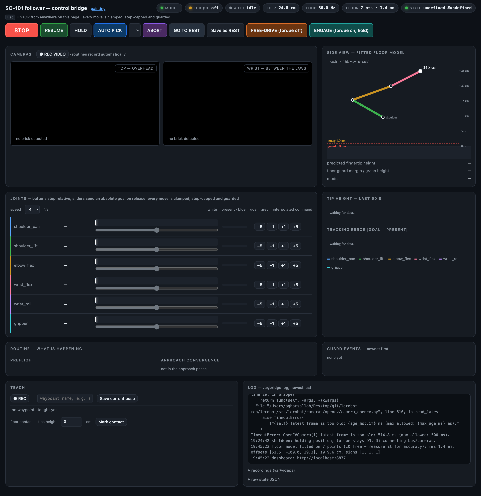
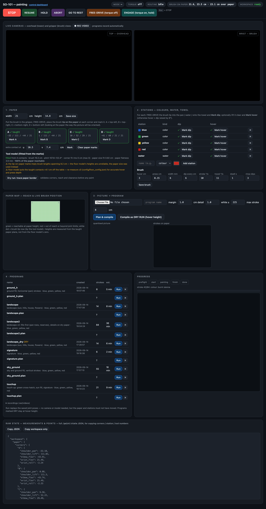

# SO-101 control bridge

A Python daemon that owns an SO-101 follower arm and its two cameras. Everything else — an operator at
the dashboard, an AI agent writing JSON files, the built-in autonomous pick-and-place — sends *goals*
to it. The daemon enforces every safety rule itself, so a bad command becomes a slow, limited or
refused move, never a jerk and never a push into the table.

```bash
uv sync                 # install (lerobot comes from ../lerobot)
uv run so101-bridge     # start the daemon; dashboard on http://localhost:8765
```

Stop the arm at any time: the dashboard **STOP** button, `scripts/STOP.command` (double-click in
Finder), or `touch ESTOP` in any terminal. Clear it with **RESUME** or `scripts/RESUME.command`.

**Read [`docs/operations.md`](docs/operations.md) before touching the arm** — it is the operator and
agent manual: startup, the command interface, the state format, what every log line means, and what
to do when something goes wrong.

## Demos

| Balloon lab — aim by wrist camera, thrust, pop | Jenga lab — push one brick out of row 11 | Drawing lab — جمعة مباركة in Kufic, with a pen |
| --- | --- | --- |
| <video src="docs/videos/20261112_164353_pop_orange3.mp4" controls muted width="100%"></video> | <video src="docs/videos/jenga_row11_take4_x.mp4" controls muted width="100%"></video> | <video src="docs/videos/draw_jumua_x.mp4" controls muted width="100%"></video> |
| [`pop_orange3.mp4`](docs/videos/20261112_164353_pop_orange3.mp4) — the needle is lined up on the orange balloon from the wrist image, then driven along a straight horizontal line and stopped the moment the orange disappears | [`jenga_row11_take4_x.mp4`](docs/videos/jenga_row11_take4_x.mp4) — stick mounted as a tool, camera line-up, a 4.5 cm push drops the middle brick out the back, stick pulled out | [`draw_jumua_x.mp4`](docs/videos/draw_jumua_x.mp4) — pen taped to the jaw at 45°, paper height measured by touch, outlines drawn right to left; 4.5 min sped up to 1 min, tower view above the wrist view (black where the wrist camera dropped out) |

All runs are fully guarded: every move is a request to the control loop, with the tool tip protected by the
table guard. See [Labs](#labs) below; to cut a take like these for sharing, see [Sharing a take](#sharing-a-take).

## Screenshots

| Control dashboard (`/`) | Painting page (`/paint`) |
| --- | --- |
| [](docs/img/dashboard.png) | [](docs/img/paint.png) |

Status chips, camera streams, to-scale floor-model side view, per-joint tracks/load/charts, routine and
guard-event panels, log tail (left); paper/station teaching, tool-model fit, reachability map, picture →
program compiler and saved programs (right). Rendered with mock state, no arm attached — real values fill
in once the daemon is running.

## Documentation

| File | What it covers |
| --- | --- |
| [`docs/operations.md`](docs/operations.md) | **the manual.** Start/stop, safety rules the daemon enforces, dashboard panels, standard procedures (auto pick, rest, jogging, teaching), the full command/state/log interface, joint-geometry cheat sheet, failure → remedy table, file layout |
| [`docs/learnings.md`](docs/learnings.md) | why things are the way they are: hardware/firmware quirks, joint conventions, the floor model, vision tuning — the reasoning behind the rules in `operations.md` |
| [`docs/metadata.json`](docs/metadata.json) | every calibrated number, machine-readable: motor IDs/gains, camera indices, joint limits and conventions, guard thresholds, floor-model fit, vision gates, known poses, painting tuning |
| [`docs/decision-log.json`](docs/decision-log.json) | chronological log of tuning decisions and why each was made |
| [`docs/motion-log-pick-place.md`](docs/motion-log-pick-place.md) | run-by-run log of pick-and-place attempts |
| [`docs/lab.md`](docs/lab.md) | the lab template: anatomy, actions, moving the arm, staging, panels, cameras, model/LLM hooks, tests — read before starting a new experiment |
| [`docs/jenga.md`](docs/jenga.md) | the Jenga lab: setup, how a turn is judged, calibration numbers and what the sessions taught |
| [`docs/draw.md`](docs/draw.md) | the drawing lab: pen at 45°, measuring the paper by touch, built-in drawings, what is still open |

## Helpers

| Command | Effect |
| --- | --- |
| `make run` (`uv run so101-bridge`) | start the daemon; dashboard on http://localhost:8765 |
| `make test` (`uv run pytest -q`) | unit tests, no hardware needed |
| `make lab NAME=<name> TITLE="..." DESC="..."` | scaffold a new lab on the template, served at `/<name>` (see `docs/lab.md`) |
| `uv run python -m so101_bridge.camera_ids` | list the connected cameras in OpenCV order: index, name, USB port id and the `"model#n"` selector for `CAMS` |
| `make lint` / `make fmt` | `ruff check` / `ruff check --fix` |
| `make stop` (`touch ESTOP`) | freeze the arm right now, from any terminal |
| `make resume` (`rm -f ESTOP`) | clear the emergency stop |
| `make clean` | drop `var/` runtime artifacts (keeps `config/`) |
| `scripts/STOP.command` / `RESUME.command` / `RELEASE.command` | double-click in Finder: STOP, RESUME, torque off |
| `scripts/paint.sh <plan> [from_stroke]` | compile `paintings/<plan>.plan.json` and run it without a browser or agent; `DRY=1` runs the same moves at hover height (see `docs/operations.md` §11) |
| `scripts/chess.sh <command>` | teach the board, fit it, and play a whole game from a terminal — `teach`, `done`, `compile`, `verify`, `new`, `play`, `wait`, `move`, `confirm` (see `docs/operations.md` §12) |
| `scripts/chess.sh learned` / `apply <id>` | what the accumulated history says about grasps and squares, and applying one of its suggestions to `config/chess.json` |

Emergency stop is always a `touch ESTOP` away at the repository root, and always cleared with `make resume` or the
dashboard **RESUME** button — restarting the bridge never drops torque, the arm holds its pose through a restart.

## Layout

| Path | What it holds |
| --- | --- |
| `src/so101_bridge/` | the package (see below) |
| `config/` | what you may edit: `limits.json`, `rest.json`, `floor_points.json`, `waypoints.json`, and optional overlays `settings.json` (any constant in `settings.py`, see `settings.example.json`) and `poses.json` (taught paths, see `poses.example.json`) |
| `var/` | runtime only, never committed: `bridge.log`, `state.json`, `cmd/`, `done/`, `recordings/`, camera snapshots |
| `scripts/` | double-clickable `STOP` / `RESUME` / `RELEASE` for the operator |
| `docs/` | operations manual, learnings, machine-readable `metadata.json`, decision log, lab guides; `docs/videos/` holds the demo clips |
| `var/videos/lab/`, `var/lab/<lab>_runs/` | every lab take, filmed and logged (plan, paths sent, telemetry) |
| `paintings/` | compiled painting programs (`<name>.json`): joint poses for every step, replayable without model or cameras |
| `puzzles/` | chess puzzles: a FEN, which colour the robot plays and the solution line |
| `config/teach/` | guided teaching sessions: what the daemon asks the operator to do, step by step |
| `var/games/` | one document per chess game (`<id>.json`) plus a PGN mirror — the ~300-byte file the LLM reads |
| `var/chess_history.jsonl` | every grasp, place and verification ever attempted — the evidence behind the suggestions on `/chess` |
| `tests/` | unit tests for the parts that need no hardware |
| `ESTOP` | presence of this file freezes the arm; kept at the root so it is one short `touch` away |

## Modules

| Module | Responsibility |
| --- | --- |
| `app.py` | entry point and the 30 Hz control loop — the only code that talks to the motor bus |
| `hardware.py` | connect, motor gains, soft-limit derivation |
| `controller.py` | shared state, command queue, recording, waypoints, motion helpers |
| `routines.py` | registry of named routines; a routine is `run(ctrl)` that only requests goals and reports `ctrl.phase(...)` |
| `autopick.py` | the built-in `pick_place` routine (registered via `@routine`) |
| `shared/` | what every task needs: tool-tip kinematics on a taught flat surface (`plane.py`), path/densify/travel helpers (`motion.py`), JSON config helpers (`store.py`), guided teaching sessions (`teach.py`) |
| `paint/` | painting: taught workspace (`workspace.py`), brush-tip kinematics on the paper plane (`kinematics.py`), picture → hatch strokes (`planner.py`), strokes → replayable joint program (`program.py`), the `paint` routine (`routine.py`) |
| `chess/` | chess: taught board (`workspace.py`), gripper kinematics on the board (`kinematics.py`), overhead board reading (`vision.py`), rules and occupancy → move (`game.py`), who chooses the move (`players.py`), move → arm motion (`physical.py`), the game document (`log.py`), what every attempt taught us (`history.py`), the routines (`routine.py`) |
| `lab/` + `web/lab/` | the generic lab template every experiment builds on: guards, cameras, joints, side view, points, reach envelope, tool, staging |
| `labs/` + `web/<name>/` | one module and one panel set per experiment (`balloon`, `jenga`, …) |
| `floor.py` | fitted floor model: predicted fingertip height, the guard that protects the table |
| `vision.py` | brick detection and the dashboard overlay |
| `dashboard.py` + `web/dashboard.html` | local HTTP dashboard (status chips, camera streams, to-scale side view of the floor model, joint tracks with load, tip-height and tracking-error charts, log tail) and the JSON/MJPEG interfaces |
| `settings.py` | hardware identity and tuning constants (defaults); override per deployment in `config/settings.json` or `$SO101_SETTINGS` |
| `paths.py` | where config and runtime files live |
| `poses.py`, `util.py` | proven joint poses; logging and atomic writes |

## Dashboard overview

Header chips (mode, torque, routine, predicted tip height, loop rate, floor model, state age) and the
control bar; <kbd>Esc</kbd> triggers STOP from anywhere on the page. Panels: camera streams with the
detection overlay; to-scale side view of the arm as the floor model sees it; joint tracks (present /
goal / command, load vs guard limit, jog buttons and sliders); tip-height and tracking-error charts;
**Routine** (phase tracker with timings, preflight checklist, approach-convergence gauges);
**Guard events** (what the safety layer did, newest first); Teach (REC, waypoints, floor contacts); log tail.

`/state` carries everything the page shows — `progress`, `events`, `preflight`, `routines` — so an
agent can follow a run without the page. Start a routine with `/cmd?a=routine&name=pick_place` or a
`{"action": "routine", "name": "pick_place"}` command file.

## Painting (http://localhost:8765/paint)

1. **Paper** — enter the paper size; with the brush in the gripper, FREE-DRIVE the brush tip onto each corner
   (A top-left, B top-right, C bottom-right, D bottom-left) and mark it. The tool model is fitted from these
   marks: brush pitch and length, and the arm→paper mapping; the page shows the fit residuals and a
   reachability map of the paper. *Dry run: trace paper border* moves along the border at hover height.
2. **Stations** — add colour pans (with their colour), the water cup and a towel; mark the dip pose for each
   (and optionally a hover pose).
3. **Picture → program** — upload a picture; it is quantised to the taught colours, hatched with strokes at the
   brush width, and compiled to a program of guarded `path` steps (dips, rinses, strokes) saved in `paintings/`.
   *Compile as DRY RUN* keeps every stroke at hover height.
4. **Programs** — Run replays the saved joint poses (no camera or model needed; paper and stations must not
   have moved). Progress shows the phase, current colour/stroke and the strokes painted so far.

Requires the floor model (the tool model builds on its fitted chain). Poses in a program are precomputed,
so a picture painted once can be painted again later from the saved file.

## Chess (http://localhost:8765/chess)

First moves played on the arm in step mode (a stepped pass first, autonomous after); the hardware session
procedure is `docs/operations.md` §12.6.

1. **Teach** — the daemon reads out an 18-step session (`config/teach/chess_board.json`): free-drive the
   closed fingertips onto the centres of a1, h1, h8 and a8, two check squares, then grip each kind of
   piece once and mark the handover, feed and reserve spots. Press Done at each step; everything is
   written to `config/chess.json` as it is recorded.
2. **Fit** — the board model puts the jaws on any square at any height. The gripper's reach is given
   rather than fitted, so a mis-measured jaw offset shows up as a residual instead of being absorbed.
   The page prints the lean each of the 64 squares needs at grasp, hover and carry height.
3. **Verify** — the arm visits every taught point so you can see where the tip really lands.
4. **Play** — the human's move is read from the overhead camera (occupancy diff against the position the
   rules engine already knows) or typed; the robot's is chosen by an engine, a scripted puzzle line or
   the LLM, and executed as pick/place actions with every guard still in force. Anything the arm cannot
   do — an unreachable square, an ambiguous reading, a promotion — becomes a `needs` a person answers.

5. **Watch and learn** — the page draws the position, what the camera sees against what should be there,
   the arm and the board in a to-scale side view, the live joint pose (copyable, as JSON or as a ready
   command), grasp success per piece and the squares that keep going wrong. Every attempt is appended to
   `var/chess_history.jsonl`, and once there is enough evidence the page suggests concrete edits —
   *lower the knight's grasp height by 3 mm*, *raise the pawn's miss threshold* — each with an Apply
   button. Nothing is ever applied on its own.

The LLM never sees a frame and never applies a rule: it reads `var/games/<id>.json` and writes one move.

## Labs

Every new experiment is a **lab** on the `/lab` template (`docs/lab.md`): one Python module in
`src/so101_bridge/labs/` and one panel set in `web/<name>/`, served at `/<name>`. It gets STOP, cameras,
jogging, the side view, named points, a lab-only rest and reach envelope, and the tool model for free, and it
can only move the arm through the control loop's guards. Config edits are staged for the operator to apply,
and anything that releases torque or surprises the operator is confirm-gated.

| Lab | What it does |
| --- | --- |
| `/balloon` | finds the orange balloon in the wrist camera, aims the needle by pan, thrusts on a straight line until the orange disappears, retracts. Every pop is filmed and saved with its plan and telemetry (`var/lab/balloon_runs/`) and can be replayed, optionally shifted |
| `/jenga` | with a stick mounted as a tool, plays a turn: approach, camera line-up, push the middle brick of one row out of the back, pull out. A 3-D tower view tracks which bricks are in, pushed or out. Setup and calibration in `docs/jenga.md` |
| `/draw` | with a pen taped to the jaw, draws a built-in or hand-sketched drawing on a sheet: measures the paper height by touch, lands on each line, traces the tip and films the run (`var/lab/draw_runs/`). Details in `docs/draw.md` |

```bash
make lab NAME=pour TITLE="Pouring lab" DESC="pour 50 ml from cup A into cup B"
make run && open http://localhost:8765/pour
```

### Cameras

Both cameras are the same model (Innomaker U20CAM 1080p) with the same USB serial, so nothing but the USB
port tells them apart. `settings.CAMS` therefore names them as `"Innomaker#n"`, the n-th of that model in
OpenCV's order. The laptop and OBS cameras are never opened, and two cameras never share a device. After a
reconnect the bridge checks which view moves with the arm and swaps them if needed, so any ports work. If it
cannot tell, the camera panel asks you to pick; **Assign…** and **⇄ Swap** let you choose by hand at any time.
Why: [`docs/learnings.md`](docs/learnings.md#cameras-two-identical-innomakers-2026-11-1213).

### Sharing a take

Lab takes are saved as one wide clip (`var/videos/lab/`): tower on the left, wrist on the right, 960×540 each.
For X/Twitter, stack the two views (each stays full width, so both stay legible) and speed the take up to about a
minute. 8:9 is within X's accepted ratios and takes more of the timeline than a wide clip:

```bash
IN=var/videos/lab/<take>.mp4; OUT=${IN%.mp4}_x.mp4; SECS=60
DUR=$(ffprobe -v error -show_entries format=duration -of csv=p=0 "$IN")
ffmpeg -i "$IN" -filter_complex "[0:v]crop=960:540:0:0[t];[0:v]crop=960:540:960:0[w];\
[t][w]vstack=inputs=2,setpts=PTS*$SECS/$DUR,fps=30,scale=1080:1216:flags=lanczos,setsar=1[v]" \
  -map "[v]" -an -c:v libx264 -preset slow -crf 20 -profile:v high -level 4.1 -pix_fmt yuv420p -movflags +faststart "$OUT"
```

For the README, a lighter copy is enough: `ffmpeg -i "$OUT" -vf scale=720:-2 -c:v libx264 -crf 26 -pix_fmt yuv420p
-movflags +faststart -an docs/videos/<name>.mp4` (about 2 MB a minute).

## Development

```bash
uv run pytest        # unit tests (no hardware needed)
uv run ruff check .  # lint
```

Safety rules live in the control loop (`app.control_loop`) and in `Controller`; the routines can only
*request* goals, never bypass a guard. Keep it that way when adding behaviour.
